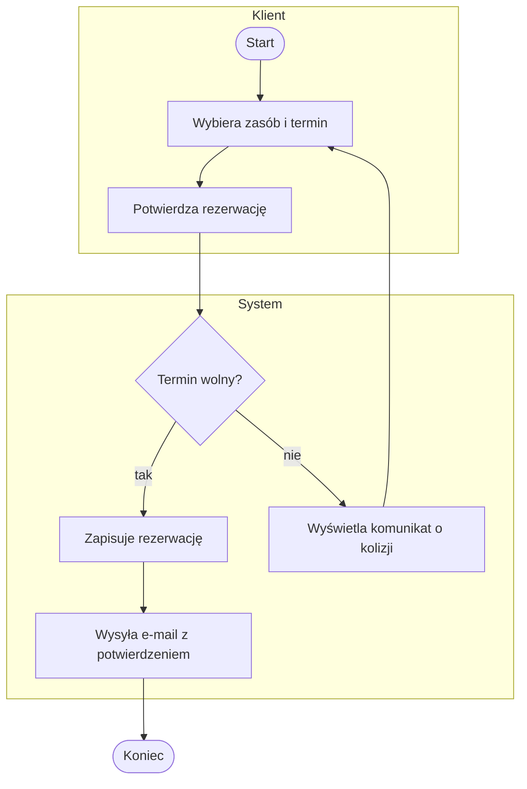
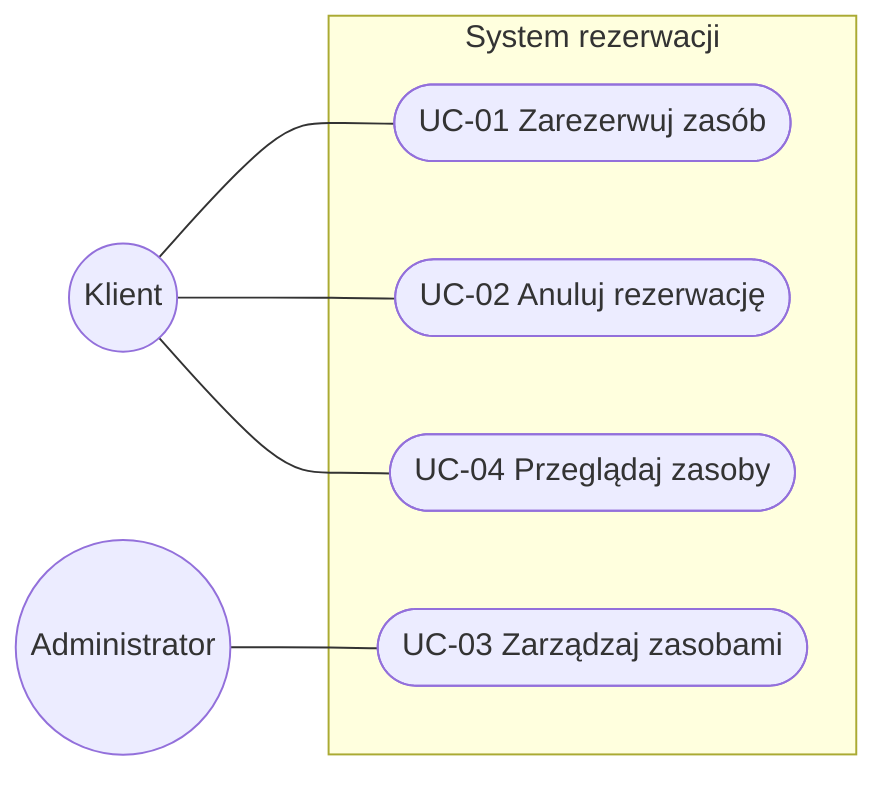
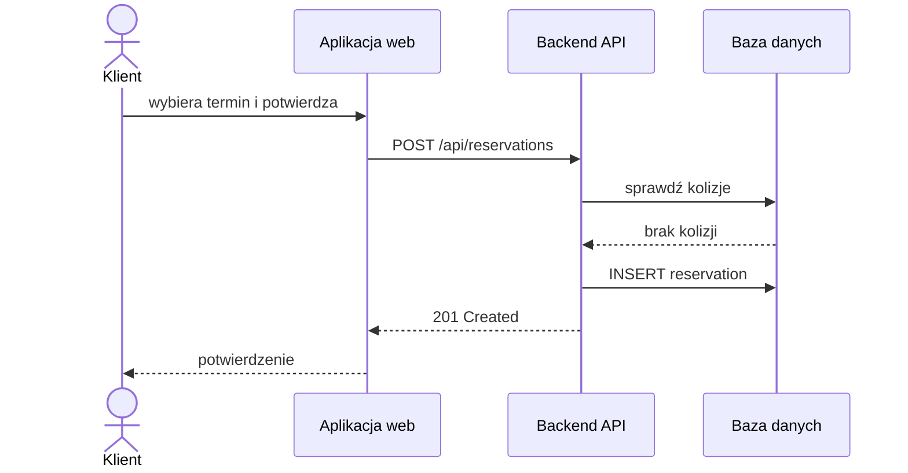
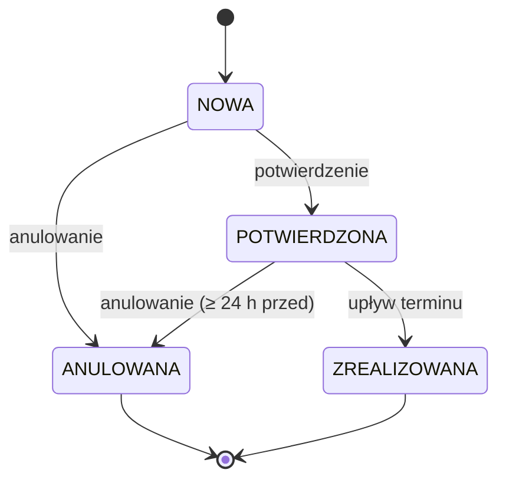

# 04. Procesy i przypadki użycia

## 4.1. Procesy biznesowe

<!-- 2–4 najważniejsze procesy. Diagram aktywności z torami (subgraph = tor/aktor). -->

### PB-01: [Nazwa procesu, np. Obsługa rezerwacji]

- Zdarzenie inicjujące: …
- Rezultat: …
- Uczestnicy: …

## 4.2. Diagram przypadków użycia

<!--
Mermaid nie ma natywnego diagramu UC – stosujemy flowchart z konwencją:
aktor = węzeł ((nazwa)), przypadek użycia = węzeł ([UC-xx nazwa]), granica systemu = subgraph.
Alternatywnie PlantUML (renderowany w GitLab; na GitHub – jako obraz wygenerowany z pliku .puml).
-->

## 4.3. Specyfikacje przypadków użycia

### UC-01: Zarezerwuj zasób

| Pole | Opis |
|---|---|
| Aktor główny | Klient |
| Cel | |
| Powiązania | WF-01, US-01 |
| Warunki początkowe | Klient jest zalogowany. |
| Warunki końcowe (sukces) | Rezerwacja zapisana ze statusem POTWIERDZONA. |
| Wyzwalacz | |

**Scenariusz główny:**

1. Klient wybiera opcję „Nowa rezerwacja”.
2. System wyświetla listę zasobów.
3. …

**Scenariusze alternatywne / wyjątki:**

- 4a. Termin zajęty: System wyświetla komunikat i proponuje najbliższy wolny termin. Powrót do kroku 3.

## 4.4. Diagramy sekwencji kluczowych interakcji

## 4.5. Diagramy stanów (dla obiektów z cyklem życia)

