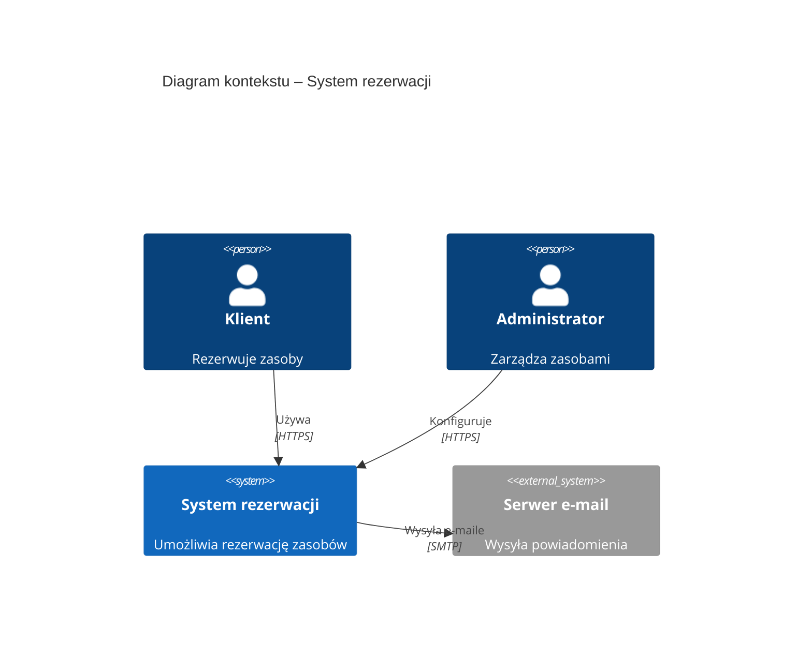
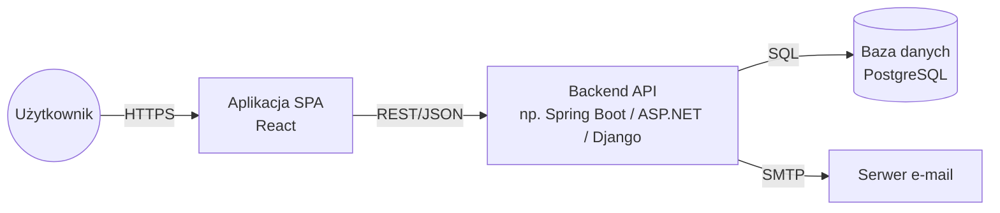

# 05. Architektura systemu

## 5.1. Styl architektoniczny i uzasadnienie

<!-- np. monolit modularny / trójwarstwowa aplikacja web / SPA + REST API. Szczegółowe uzasadnienia w ADR. -->

## 5.2. Diagram kontekstu (C4, poziom 1)

<!-- Jeśli C4Context nie renderuje się poprawnie, użyjcie flowchart z opisanymi węzłami. -->

## 5.3. Diagram kontenerów (C4, poziom 2)

| Kontener | Technologia | Odpowiedzialność |
|---|---|---|
| | | |

## 5.4. Komponenty (C4, poziom 3) – dla backendu

<!-- Moduły/komponenty i ich zależności. -->

## 5.5. Projekt API

<!-- Lista endpointów (lub odnośnik do pliku OpenAPI w docs/api/openapi.yaml). -->

| Metoda | Ścieżka | Opis | Uprawnienia | UC/US |
|---|---|---|---|---|
| POST | /api/reservations | Utworzenie rezerwacji | Klient | UC-01 |

## 5.6. Stos technologiczny (propozycja dla cz. 2)

| Warstwa | Technologia | Uzasadnienie (ADR) |
|---|---|---|
| Frontend | | |
| Backend | | |
| Baza danych | | |
| Testy | | |

## 5.7. Decyzje architektoniczne

Lista ADR w katalogu [adr/](adr/):

| ADR | Tytuł | Status |
|---|---|---|
| [ADR-0000](adr/0000-wzor-adr.md) | Wzór (nie usuwać, kopiować) | wzór |
| ADR-0001 | [pierwsza decyzja zespołu] | |
