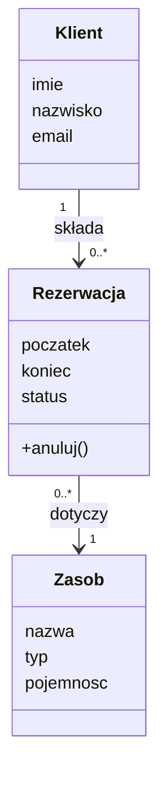
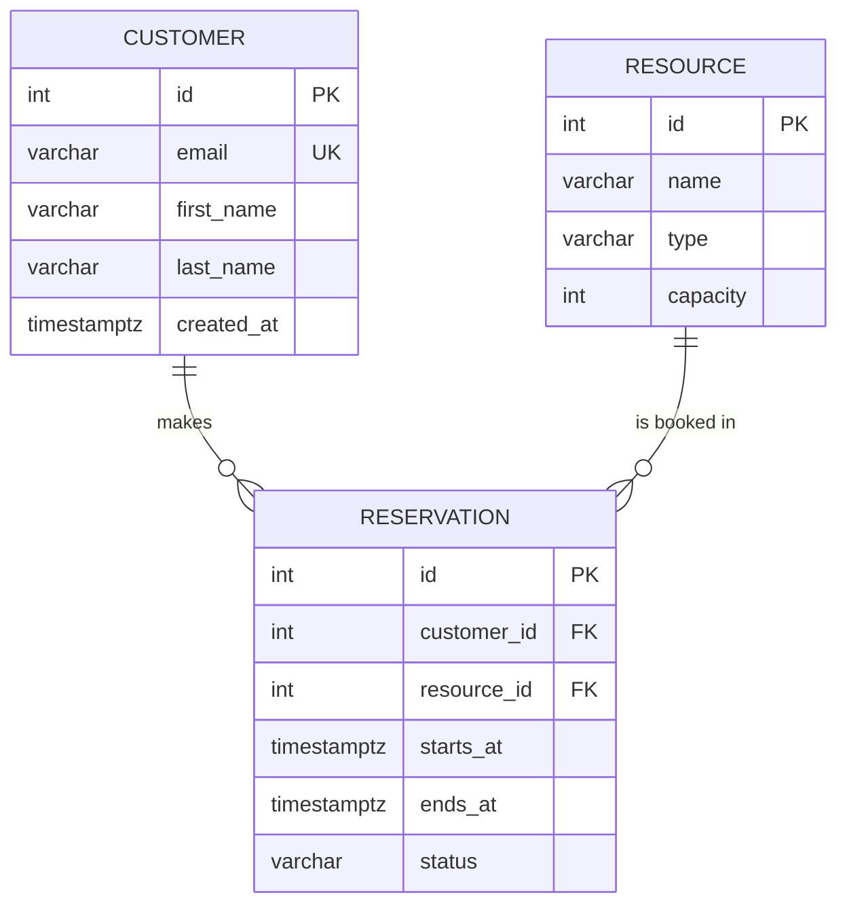

# 06. Model danych

## 6.1. Model dziedziny (diagram klas)

<!-- Pojęcia ze słownika → klasy. Atrybuty bez typów technicznych, z liczebnościami asocjacji. -->

## 6.2. Model logiczny/fizyczny bazy danych (ERD)

<!-- Docelowy SZBD (np. PostgreSQL), tabele w 3NF (świadome odstępstwa – uzasadnić). -->

## 6.3. Słownik danych

### Tabela `reservation`

| Kolumna | Typ | Null | Domyślnie | Ograniczenia | Opis |
|---|---|---|---|---|---|
| id | SERIAL | nie | | PK | |
| customer_id | INT | nie | | FK → customer.id, ON DELETE RESTRICT | |
| starts_at | TIMESTAMPTZ | nie | | starts_at < ends_at | |
| status | VARCHAR(20) | nie | 'NOWA' | CHECK IN ('NOWA','POTWIERDZONA','ANULOWANA','ZREALIZOWANA') | |

## 6.4. Indeksy i reguły integralności

| Obiekt | Definicja | Cel |
|---|---|---|
| idx_reservation_resource_time | (resource_id, starts_at, ends_at) | szybkie wykrywanie kolizji (WNF-01) |

## 6.5. Dane wrażliwe i retencja

| Dane | Kategoria (osobowe / wrażliwe / zwykłe) | Ochrona | Okres przechowywania |
|---|---|---|---|
| email klienta | osobowe | | |

## 6.6. Dane początkowe i testowe

<!-- Jakie dane słownikowe muszą istnieć przy starcie? Jak wygenerujemy dane testowe w cz. 2? -->
