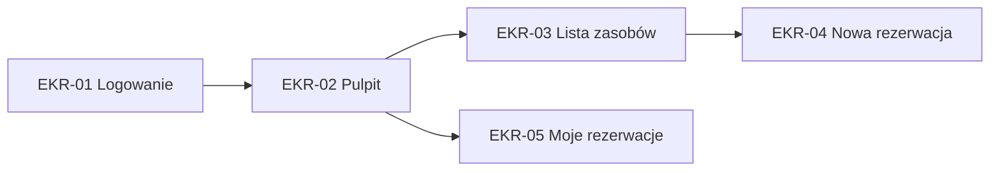
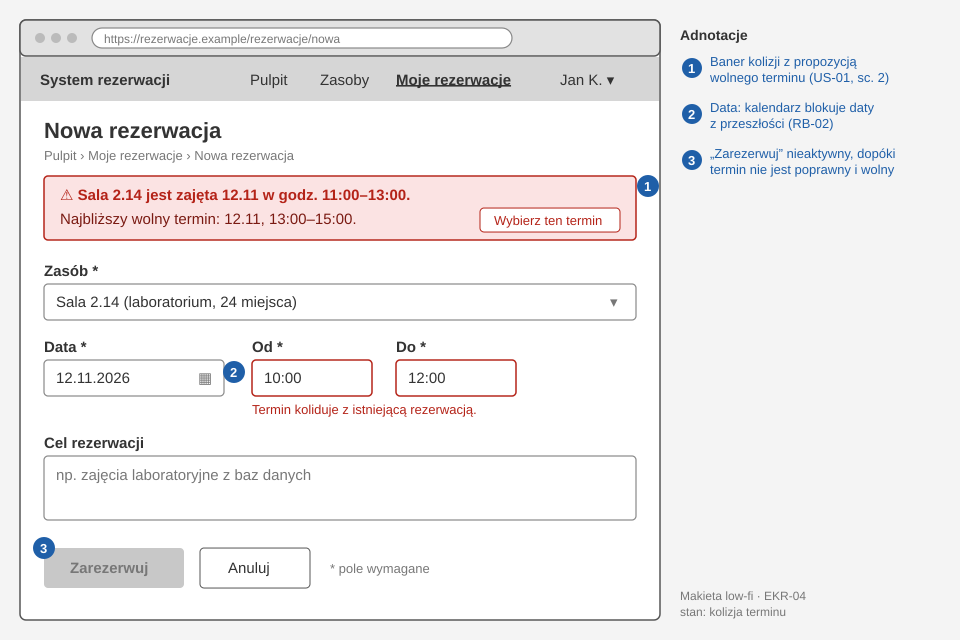

# 07. Interfejs użytkownika

Źródło makiet: [link do pliku Figma/Penpot, dostęp „can view” dla prowadzącego]

## 7.1. Persony

### Persona 1: [Imię, wiek, rola]

- **Kontekst:** …
- **Cele:** …
- **Frustracje:** …
- **Urządzenia / kompetencje cyfrowe:** …

## 7.2. Mapa ekranów (nawigacja)

## 7.3. Przepływy użytkownika (user flows)

<!-- Dla kluczowych historyjek: kroki użytkownika przez ekrany, w tym ścieżki błędów. -->

## 7.4. Makiety ekranów

### EKR-04: Nowa rezerwacja

<!-- Przykładowa makieta (stan błędu: kolizja terminu). Eksport z Figma/Penpot zapisujcie jako PNG lub SVG w katalogu makiety/. -->

| Element | Zachowanie / walidacja | Powiązanie |
|---|---|---|
| Pole „Data” | nie można wybrać daty z przeszłości | US-01, RB-02 |
| Przycisk „Zarezerwuj” | nieaktywny, dopóki nie wybrano terminu | |
| Komunikat kolizji | czerwony baner nad formularzem + propozycja wolnego terminu | US-01 sc. 2 |

## 7.5. Przewodnik stylu (minimalny)

| Element | Ustalenie |
|---|---|
| Kolory podstawowe | (z kontrastem ≥ 4.5:1 dla tekstu) |
| Typografia | |
| Komponenty | np. biblioteka MUI / Bootstrap / shadcn |
| Ton komunikatów | |

## 7.6. Ocena heurystyczna (10 heurystyk Nielsena)

| Heurystyka | Jak spełniona w projekcie / znalezione problemy |
|---|---|
| 1. Widoczność stanu systemu | |
| 2. Zgodność z rzeczywistością | |
| 3. Kontrola i swoboda użytkownika | |
| 4. Spójność i standardy | |
| 5. Zapobieganie błędom | |
| 6. Rozpoznawanie zamiast przypominania | |
| 7. Elastyczność i efektywność | |
| 8. Estetyka i minimalizm | |
| 9. Pomoc w rozpoznawaniu i naprawie błędów | |
| 10. Pomoc i dokumentacja | |

## 7.7. Dostępność (WCAG 2.2 AA) — lista kontrolna

- [ ] Kontrast tekstu ≥ 4.5:1
- [ ] Wszystkie funkcje dostępne z klawiatury, widoczny fokus
- [ ] Etykiety pól formularzy, komunikaty błędów powiązane z polami
- [ ] Teksty alternatywne obrazów
- [ ] Brak informacji przekazywanej wyłącznie kolorem
- [ ] Responsywność (szerokość 320 px bez przewijania poziomego)

## 7.8. Wyniki testów użyteczności

<!-- Test korytarzowy (hallway testing) z zajęć 4 i ewentualne kolejne testy: zadanie, uczestnik, obserwacje, znalezione problemy i zmiany wprowadzone w makietach. -->

| Data | Zadanie testowe | Uczestnik (rola) | Zaobserwowane problemy | Zmiana w projekcie |
|---|---|---|---|---|
| | | | | |
