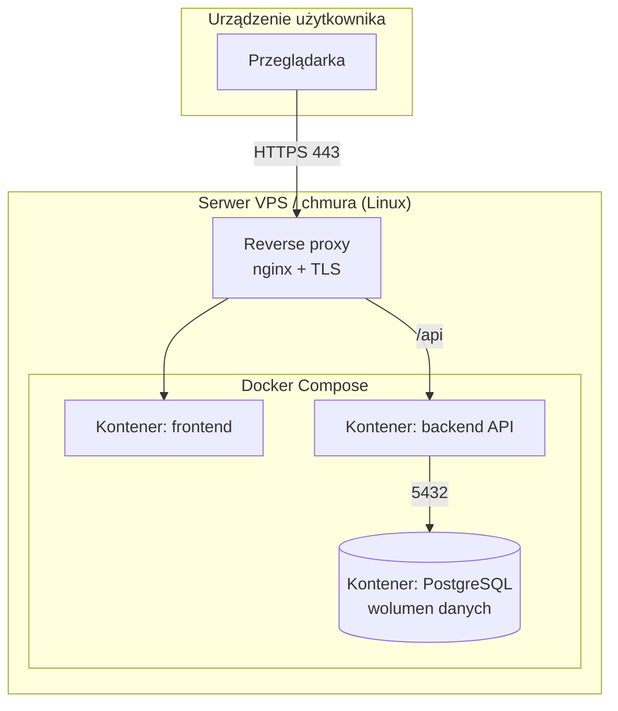
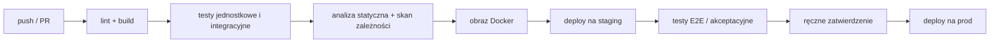

# 09. Model wdrożenia

## 9.1. Środowiska

| Środowisko | Przeznaczenie | Gdzie | Dane |
|---|---|---|---|
| dev | praca programistów | lokalnie (Docker Compose) | dane testowe |
| test/staging | testy akceptacyjne | np. darmowy hosting / serwer uczelni | dane testowe |
| prod | użytkownicy | | dane rzeczywiste |

## 9.2. Diagram wdrożenia

## 9.3. Potok CI/CD (opcjonalnie)

<!-- Sekcja NIEOBOWIĄZKOWA. Jeśli zespół chce, może naszkicować automatyzację budowania, testów i wdrożenia (np. GitHub Actions / GitLab CI). Jeśli nie – usuńcie tę sekcję, a procedurę budowania i uruchomienia opiszcie krótko w 9.5. -->

## 9.4. Konfiguracja i sekrety

<!-- Zmienne środowiskowe, gdzie przechowywane sekrety (np. plik `.env` poza repozytorium), czego nie commitujemy. -->

## 9.5. Plan wdrożenia u klienta

| Krok | Opis | Odpowiedzialny |
|---|---|---|
| 1 | Przygotowanie infrastruktury | |
| 2 | Migracja / import danych początkowych | |
| 3 | Szkolenie użytkowników | |
| 4 | Uruchomienie pilotażowe | |
| 5 | Odbiór (testy akceptacyjne klienta) | |

## 9.6. Kopie zapasowe, monitoring, utrzymanie

- Backup: częstotliwość, retencja, test odtworzenia …
- Monitoring i logi: …
- Procedura wycofania wersji (rollback): …
